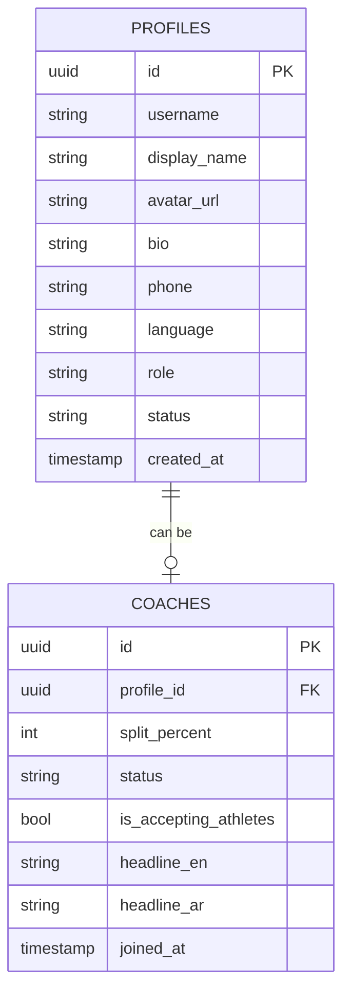
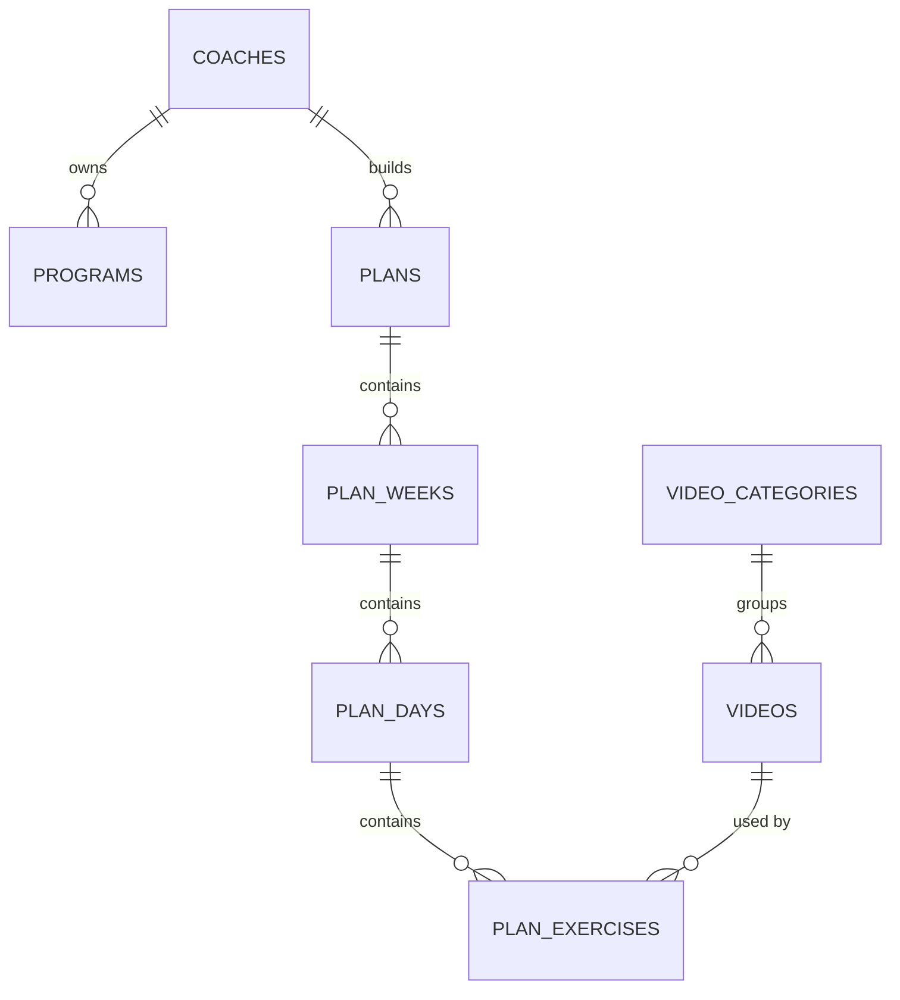
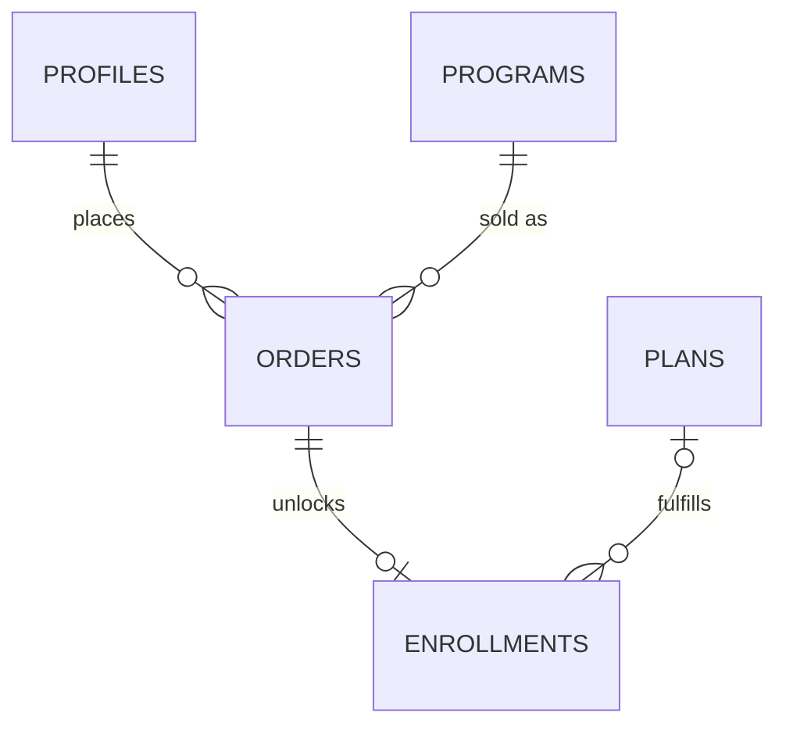
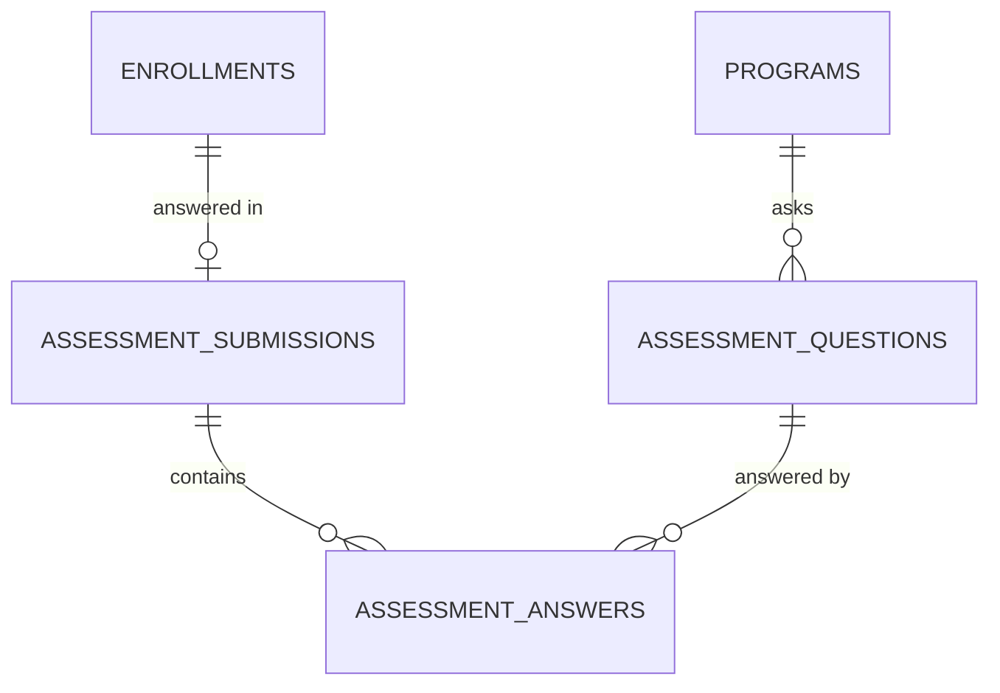
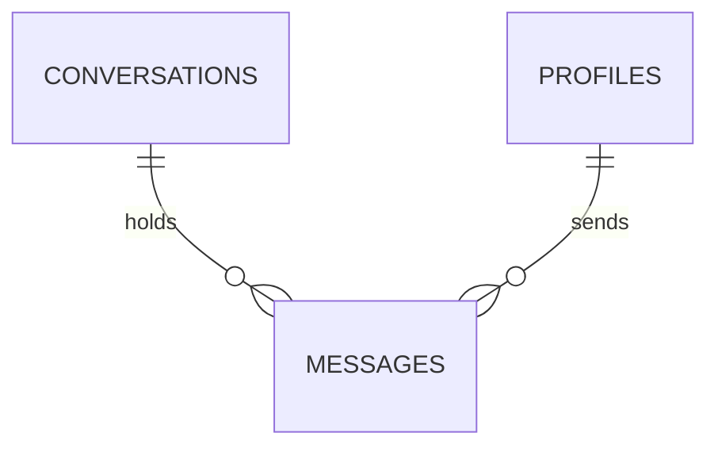
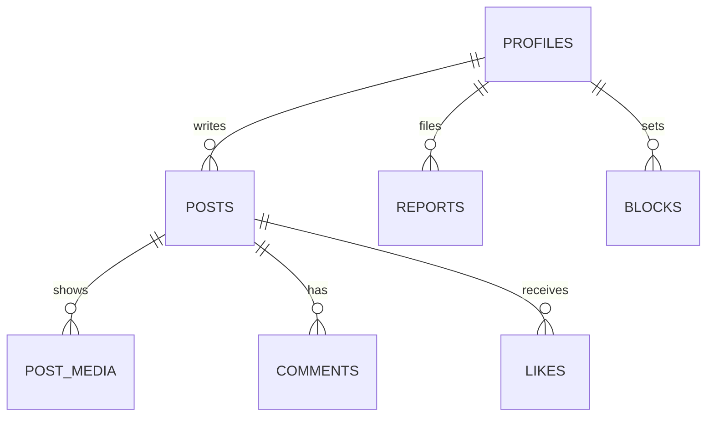

# Unlimited coach app — Step 1: complete database design

**Status:** draft for Hatem's review · **Version target:** 0.1.0 (v1 = head coach only)
**Stack:** Flutter + Supabase (Postgres). Program checkout happens on the website (Apple-safe); the app sells nothing in-app, so Apple/Google take 0%.

This document is the full answer to "what must the system remember?" — every table, every column, and why it exists. Names are proposals until Hatem approves them.

---

## 0. Locked decisions this design obeys

1. v1 = head coach only; every table keeps the marketplace seam (things belong to *a* coach, there just happens to be one).
2. Program checkout on the existing website via Paymob + InstaPay screenshot; the app never sells anything in-app — programs are digital and sold only on the web.
3. Coach settlement is manual — no automated payouts; the system only reports earnings truthfully.
4. Access clock starts at **coach approval**: `starts_at = approval moment`, `ends_at = starts_at + duration_days`.
5. Competitions v1 = announce + in-app register; results announced via community posts.
6. Reviews ship in v1, tied to enrollments (verified buyers only).
7. Community is Twitter-style: all roles post; coaches/head get role badges; report/block/moderate is mandatory for store approval.
8. EN/AR from birth: every user-facing text field is stored twice (`_en` / `_ar`).

## 1. Conventions (apply to every table)

- Table names: plural, `snake_case`. Column names: `snake_case`.
- Every table has `id uuid` primary key and `created_at` timestamp.
- All timestamps stored in UTC; the app displays each user's **device time** (audience is MENA-wide, not only Egypt).
- Foreign keys are named `<thing>_id` and point at the owning table.
- Lists never live inside a table — the "many" side points back (golden rule).
- Facts derivable from other tables are **computed, never stored** (single source of truth).
- User content is soft-deleted (`is_deleted` flag) so conversations don't collapse; personal data hard-deletes on account deletion (store requirement).
- Status fields are enums (fixed lists the database enforces), listed in §12.

---

## 2. Identity — `profiles`, `coaches`

**`profiles`** — one row per human. Created automatically at signup by the `handle_new_user` database function. `username` is the unique community handle. `language` (`en`/`ar`) personalizes everything including emails. `role` is the three-level pyramid `athlete → coach → admin` (each level includes the powers below). `status` (`active`/`banned`) is the moderation kill-switch. `phone` matters for support and InstaPay matching.

**`coaches`** — the coach *business* card (the human stays in `profiles`): `split_percent` (60 = coach keeps 60%), `status` (`pending`/`active`/`suspended` — v2 marketplace onboarding seam), `is_accepting_athletes` (coach flips it when full; programs show "fully booked"), bilingual `headline`.

Sign-in doors: email+password, Google, **Sign in with Apple** (Apple requires it). In-app account deletion is mandatory (Apple rule): auth record + personal fields erased, content remains as "Deleted user".

## 3. Training content — `programs`, `plans`, `plan_weeks`, `plan_days`, `plan_exercises`, `videos`, `video_categories`

**Core idea (approved):** what's *sold* (`programs`) and what's *delivered* (`plans`) are different objects. A pre-test is just a small plan. Templates are plans with `is_template = true`.

- **`programs`** — the shop card: `coach_id`, `title_en/_ar`, `description_en/_ar`, `cover_image_url`, `price_egp`, `duration_days`, `is_published`, `created_at`.
- **`plans`** — `coach_id`, `title` (single field — written for a specific athlete or template audience in the coach's chosen language), `is_template`, `created_at`.
- **`plan_weeks`** — `plan_id`, `week_number`, `title`.
- **`plan_days`** — `week_id`, `day_number`, `title`, `is_rest_day`.
- **`plan_exercises`** — `day_id`, `video_id`, `position`, `sets` (int), `reps` (**text**, so "8–12", "30s hold", and "max" all fit), `rest_seconds`, `coach_notes`.
- **`videos`** — `owner_coach_id` (v1: always head coach; v2 seam for paid own-uploads), `category_id`, `title_en/_ar`, `provider_video_id` (Cloudflare Stream/Mux ID — **never a raw URL**; the app requests short-lived signed links), `duration_seconds`, `thumbnail_url`.
- **`video_categories`** — `name_en`, `name_ar`, `slug`, `position` (admin controls order).

## 4. Money & access — `orders`, `enrollments`

- **`orders`** (approved): `order_number` (human code `UNL-1042` for support calls), `athlete_id`, `program_id`, `amount_egp` (**copied** at purchase — orders remember what was actually paid), `payment_method` (`paymob_card`/`apple_pay`/`instapay`), `status` (`pending` → `awaiting_review` → `paid` / `rejected` / `refunded`), `instapay_screenshot_url`, `rejected_reason` (athlete sees why, can re-upload), `paymob_transaction_id`, `created_at`, `paid_at`.
- **`enrollments`** (approved): `order_id`, `athlete_id`, `program_id` (kept alongside `order_id` deliberately — security rules and queries read them directly), `plan_id` (**empty until the coach assigns** — the emptiness *is* the "waiting for coach" state), `status` (`awaiting_assessment` → `awaiting_coach` → `active` → `expired`, plus `refunded`), `starts_at`, `ends_at`.

Coach earnings screen = computed from paid orders of his programs minus refunds. Stored nowhere.

## 5. Assessments — `assessment_questions`, `assessment_submissions`, `assessment_answers`

The questions live in the database, not in app code — the coach edits his questionnaire anytime **without an app update**.

- **`assessment_questions`** — `program_id`, `position`, `type` (`text` / `number` / `choice` / `photo` / `video`), `question_en`, `question_ar`, `options` (the choice list, bilingual, for `choice` type), `is_required`.
- **`assessment_submissions`** — `enrollment_id` (unique — one submission per purchase), `status` (`draft` → `submitted` → `reviewed`), `submitted_at`. Draft status lets the athlete fill half tonight, finish tomorrow.
- **`assessment_answers`** — `submission_id`, `question_id`, `answer_text` (also holds the chosen option / the number), `media_url` (private-bucket path for photo/video answers).

## 6. Chat — `conversations`, `messages`

- **`conversations`** — `athlete_id`, `coach_id`, unique per pair (one thread forever, like WhatsApp), `last_message_at` (inbox sorting).
- **`messages`** — `conversation_id`, `sender_id`, `type` (`text`/`image`), `body`, `media_url`, `created_at`, `read_at` (empty = unread; unread counts are computed).

Live delivery = Supabase Realtime subscription on `messages`. **Default chosen (veto anytime):** chat opens only with an active enrollment — the coach chats with paying athletes, not the whole internet.

## 7. Community — `posts`, `post_media`, `comments`, `likes`, `reports`, `blocks`

- **`posts`** — `author_id` (a profile — athletes, coaches, and head all post through the same door; the badge comes from `role`), `body`, `is_deleted`, `created_at`.
- **`post_media`** — `post_id`, `media_url`, `position` (multi-image posts).
- **`comments`** — `post_id`, `author_id`, `body`, `is_deleted`. **Default:** one level only (no replies-to-replies) in v1.
- **`likes`** — `post_id`, `liker_id`, unique pair (one like per person). Counts computed.
- **`reports`** — the store-mandated moderation heart, generic on purpose: `reporter_id`, `target_type` (`post`/`comment`/`review`/`profile`), `target_id`, `reason`, `status` (`open`/`actioned`/`dismissed`). One table serves every reportable thing, including future ones.
- **`blocks`** — `blocker_id`, `blocked_id`, unique pair; feed and comments hide blocked users both directions.

Feed = newest-first, paginated 20 at a time. No algorithm in v1.

## 8. Competitions — `competitions`, `competition_registrations`

- **`competitions`** — `title_en/_ar`, `description_en/_ar`, `cover_image_url`, `location_en/_ar`, `event_date`, `registration_closes_at`, `capacity` (empty = unlimited), `status` (`draft` → `published` → `registration_closed` → `finished`).
- **`competition_registrations`** — `competition_id`, `athlete_id` (name/phone come from the profile), `status` (`registered`/`cancelled`), unique pair. Results are announced as community posts (locked decision #5).

## 9. Reviews — `reviews`

- **`reviews`** — `enrollment_id` (**unique** — the review literally cannot exist without a purchase, and one purchase = one review), `rating` (1–5), `body`, `is_deleted` (moderation), `created_at`. Program and coach are derived through the enrollment; a coach's rating is the computed average across his programs.

## 10. Notifications — `notifications`, `device_tokens`, `notification_preferences`

- **`notifications`** — `recipient_id`, `type` (`order_paid`, `order_rejected`, `plan_assigned`, `expiry_soon`, `chat_message`, `post_liked`, `post_commented`, `competition_reminder`, `announcement`), `data` (the details as JSON: which order, which post), `is_read`, `created_at`. The app renders the text in the user's language from `type` + `data` — so we never store bilingual copies per notification.
- **`device_tokens`** — `profile_id`, `fcm_token`, `platform` (`ios`/`android`/`web`), `last_seen_at`. One person, many devices.
- **`notification_preferences`** — `profile_id`, `community_enabled`, `chat_enabled`, `marketing_enabled` (store rule: users must be able to mute).

## 11. Platform operations — `app_settings`, `audit_log`

- **`app_settings`** — one small key-value table the admin edits without app releases: `min_supported_version` (the force-update switch), `maintenance_mode`, `instapay_number`, `support_whatsapp`.
- **`audit_log`** — every admin/coach action that touches money or people: `actor_id`, `action` (`order_approved`, `order_rejected`, `user_banned`, `post_removed`, `plan_assigned`…), `target_type`, `target_id`, `data`. When a dispute comes ("who rejected my payment?!"), this table answers with a timestamp.

## 12. Enums (the fixed lists)

| Enum | Values |
|---|---|
| `user_role` | `athlete`, `coach`, `admin` |
| `profile_status` | `active`, `banned` |
| `coach_status` | `pending`, `active`, `suspended` |
| `payment_method` | `paymob_card`, `apple_pay`, `instapay` |
| `order_status` | `pending`, `awaiting_review`, `paid`, `rejected`, `refunded` |
| `enrollment_status` | `awaiting_assessment`, `awaiting_coach`, `active`, `expired`, `refunded` |
| `question_type` | `text`, `number`, `choice`, `photo`, `video` |
| `submission_status` | `draft`, `submitted`, `reviewed` |
| `message_type` | `text`, `image` |
| `report_target` | `post`, `comment`, `review`, `profile` |
| `report_status` | `open`, `actioned`, `dismissed` |
| `competition_status` | `draft`, `published`, `registration_closed`, `finished` |
| `notification_type` | `order_paid`, `order_rejected`, `plan_assigned`, `expiry_soon`, `chat_message`, `post_liked`, `post_commented`, `competition_reminder`, `announcement` |
| `device_platform` | `ios`, `android`, `web` |

## 13. File storage buckets (Supabase Storage)

| Bucket | Access | Holds |
|---|---|---|
| `avatars` | public | profile pictures |
| `post-media` | public | community images |
| `program-covers` | public | program & competition covers |
| `assessment-media` | **private** | athletes' assessment photos/videos |
| `payment-screenshots` | **private** | InstaPay proofs |

Program *training videos* are not in Supabase at all — they live at the video provider (Cloudflare Stream or Mux), fetched via short-lived signed links.

## 14. Deliberately NOT stored (computed truths)

- A coach's athletes → active enrollments in his programs
- Earnings → paid orders minus refunds
- Like/comment/unread counts → counted live (cached later only if needed)
- Coach rating → average of his programs' review ratings
- "Is this program unlocked for me?" → my enrollment's `status = active` and `ends_at` in the future

## 15. Defaults I chose — veto anytime

1. Chat requires an active enrollment.
2. Comments are one level deep in v1.
3. Likes on posts only (not comments) in v1.
4. Feed is chronological in v1.
5. Plan titles are single-language (coach writes for a known audience).
6. The InstaPay receiving number lives in `app_settings`, changeable without app updates.

## Next step

Step 2 — security rules: for every table above, "who may read / who may write," in plain English, then as Postgres row-level security.
