# Unlimited coach app — the visual companion

Every important structure and flow of v1, drawn. Reads together with the database design doc (same date). Boxes = things or steps; diamonds = decisions; the crow's-foot fork in ERDs = "many".

---

## 1. The big system map

Who talks to what. The app sells nothing in-app; money enters only through the website.

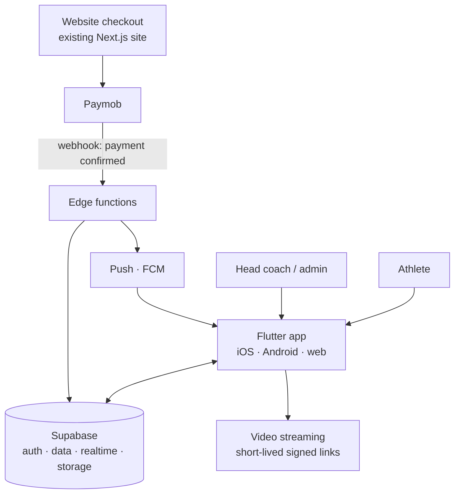

## 2. The core spine (ERD)

The chain the whole business hangs on: a human can be a coach; coaches own programs and build plans; paid orders unlock enrollments; enrollments carry the assessment, the assigned plan, and (later) the review.

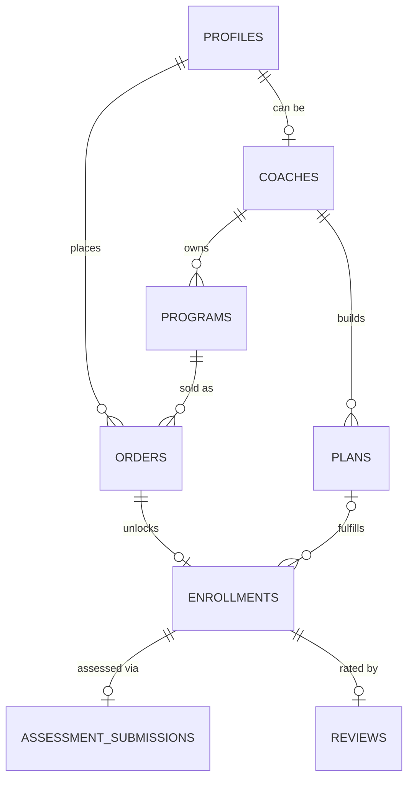

## 3. The money journey — end to end

From "I want this program" to "my access expired". This is the single most important chart in the company.

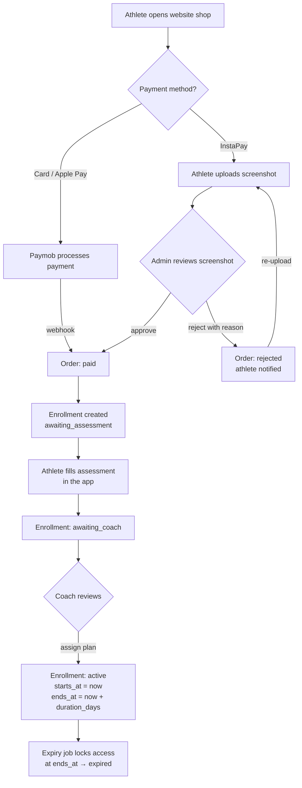

## 4. Order lifecycle (status machine)

Every order is always in exactly one of these states — no other transitions exist.

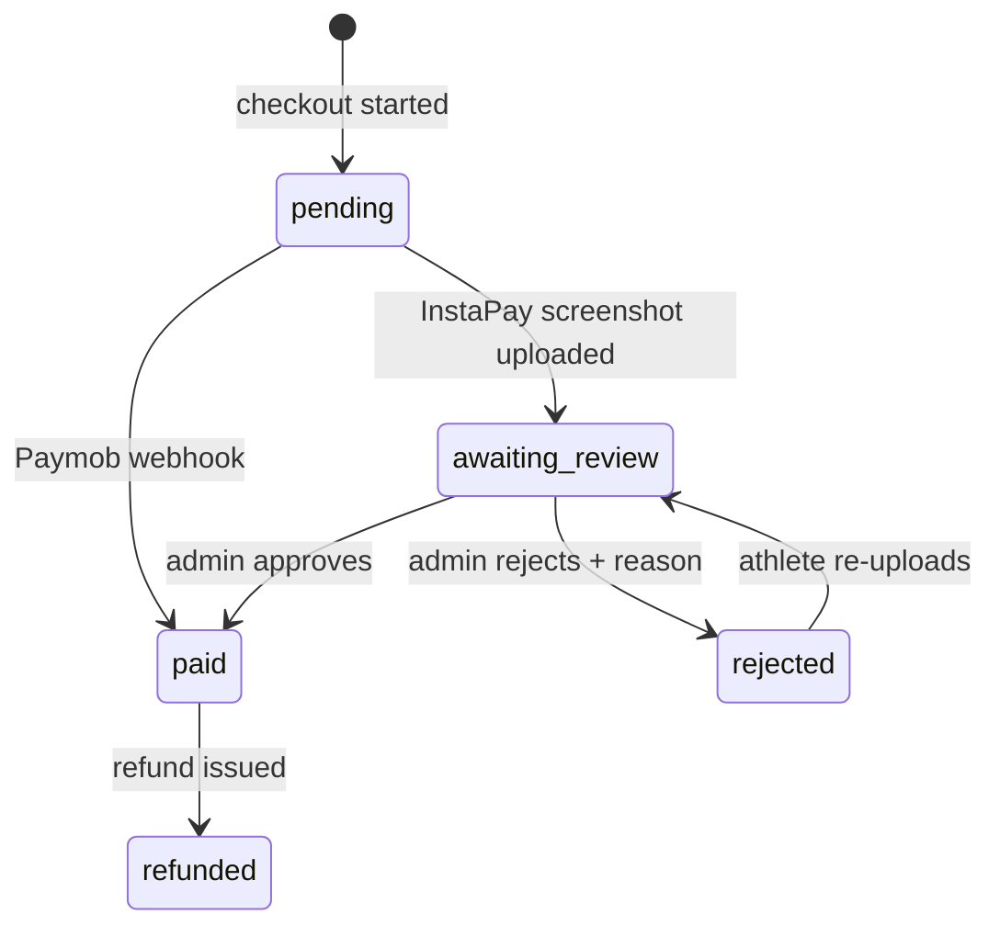

## 5. Enrollment lifecycle (status machine)

The membership card's life. The clock stamps happen exactly once, at coach approval.

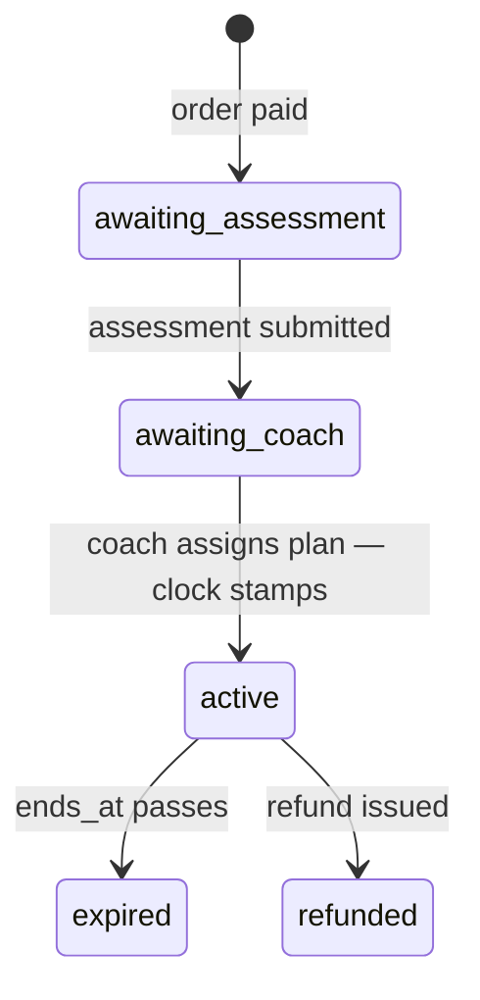

## 6. Assessment flow

Questions come from the database (coach edits them without app updates); answers flow back as text or private media.

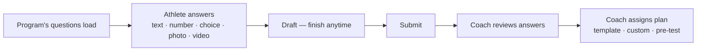

## 7. Chat — how a message travels live

The phone subscribes to its conversation; new rows arrive pushed, never polled.

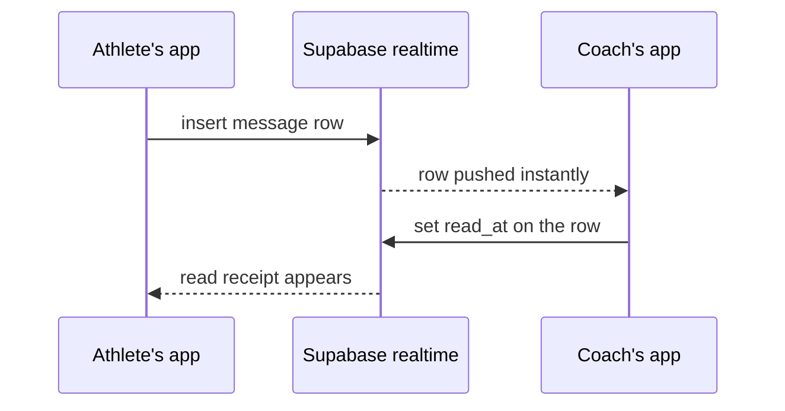

## 8. Community moderation (store-mandated)

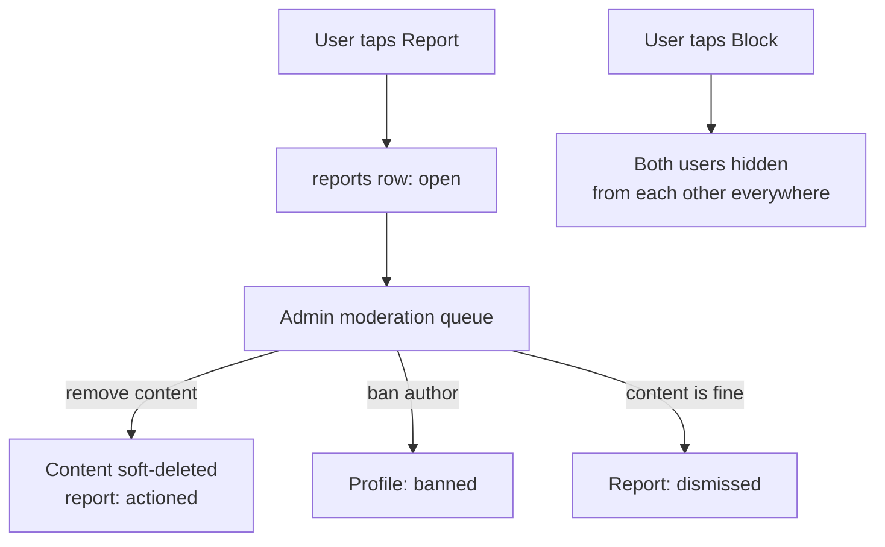

## 9. Competition lifecycle

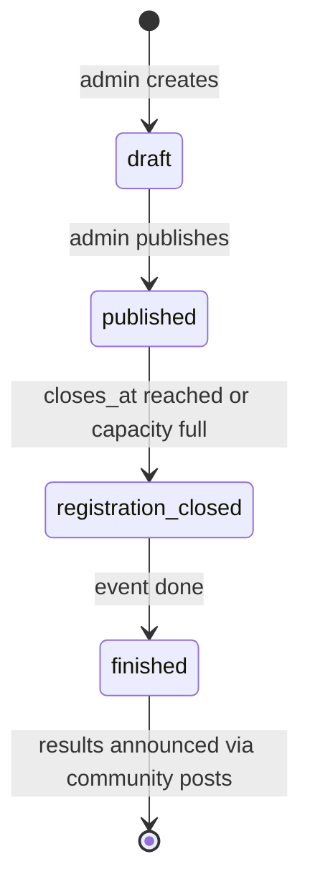

## 10. Notification pipeline

Every notification exists twice — a row (the in-app list) and, if the user hasn't muted that type, a push.

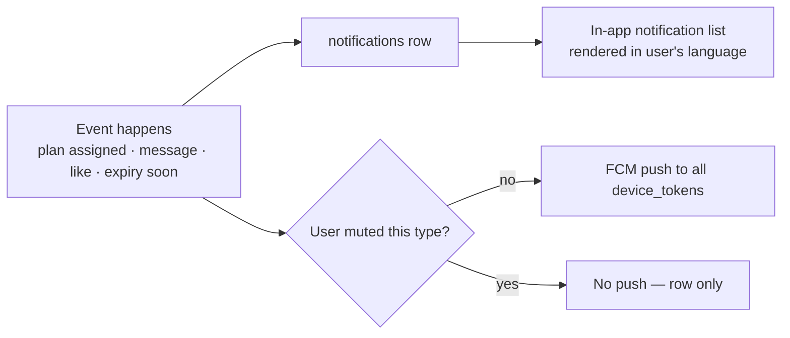

## 11. The expiry job (the 6pm lock)

A scheduled job — no human involved, runs every hour.

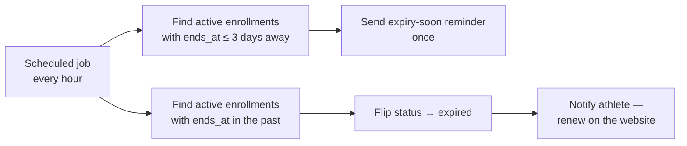
